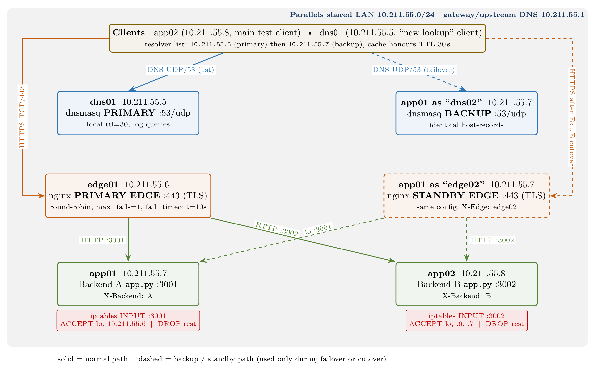
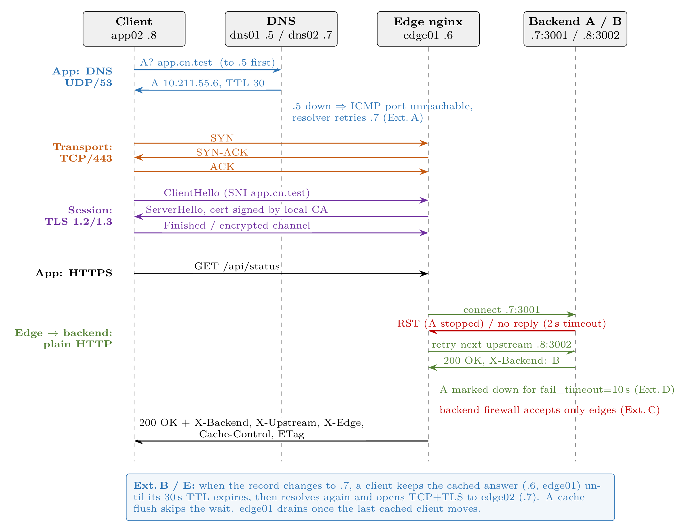

# Architecture Document: Phase 1, updated for Phase 2

Project Nexus is a private network service platform: one Mac (Parallels Desktop) running four Ubuntu VMs on a
shared LAN `10.211.55.0/24`. A client resolves `app.cn.test` through a private DNS server, opens HTTPS to an nginx
edge, and nginx load-balances to two Python backends. Phase 2 hardens that same network. Nothing was rebuilt.

| File | What it shows |
|---|---|
| [`topology.png`](topology.png) | Phase 1 topology (original) |
| [`phase2_topology.png`](phase2_topology.png) / [`.pdf`](phase2_topology.pdf) | Phase 2 topology: backup DNS, standby edge, backend firewalls |
| [`phase2_request_flow.png`](phase2_request_flow.png) / [`.pdf`](phase2_request_flow.pdf) | Request flow per protocol layer, including the Phase 2 failure paths |
| [`src/`](src/) | TikZ sources of the two Phase 2 diagrams (`tectonic <file>.tex` rebuilds them) |

## 1. Phase 2 topology

## 2. Machine roles and IP/service table

| VM | Login | IP | Phase 1 role | Added in Phase 2 |
|---|---|---|---|---|
| `dns01` | `dns01@dns01` | 10.211.55.5 | Primary DNS (dnsmasq) | TTL 30 s, exact `host-record`s, query logging. Also a test client that uses both DNS servers |
| `edge01` | `edge01@edge01` | 10.211.55.6 | nginx edge: TLS termination, reverse proxy, round-robin load balancer | Passive health checks, 2 s connect timeout, retry on next upstream, `X-Edge` / `X-Upstream` headers, upstream access log |
| `app01` | `client01@app01` | 10.211.55.7 | Backend A (`app.py`, :3001) | **Backup DNS "dns02"** (dnsmasq :53), **standby edge "edge02"** (nginx :443, normally stopped), iptables allow-list on :3001 |
| `app02` | `client02@app02` | 10.211.55.8 | Backend B (`app.py`, :3002) and client | **Main test client** (resolvers `.5` then `.7`), iptables allow-list on :3002 |
| Mac host / gateway | – | 10.211.55.1 | Parallels gateway, upstream DNS for non-project names | unchanged |

### Service map

| Service | Host:port | Protocol | Who may connect |
|---|---|---|---|
| Primary DNS | 10.211.55.5:53 | UDP/TCP 53 | all LAN clients |
| Backup DNS (dns02) | 10.211.55.7:53 | UDP/TCP 53 | all LAN clients |
| Primary edge | 10.211.55.6:443 (and :80 → 301 to :443) | HTTPS (TLS 1.2/1.3) | all LAN clients |
| Standby edge (edge02) | 10.211.55.7:443 | HTTPS | all LAN clients, only after the Ext. E cutover |
| Backend A | 10.211.55.7:3001 | HTTP | loopback (edge02) and edge01 only (Ext. C) |
| Backend B | 10.211.55.8:3002 | HTTP | edge01 and edge02 only (Ext. C) |

### DNS records (identical on dns01 and dns02)

| Name | Type | Value | TTL |
|---|---|---|---|
| `app.cn.test` | A | 10.211.55.6 (edge01) | 30 s |
| `api.cn.test` | A | 10.211.55.6 (edge01) | 30 s |

During the Ext. B and Ext. E demonstrations `app.cn.test` was temporarily changed to `10.211.55.7` and then rolled back.

## 3. Request flow per protocol layer

| Step | Layer | What happens | Phase 2 behaviour |
|---|---|---|---|
| 1 | Application (DNS), UDP/53 | Client asks `A? app.cn.test`; answer `10.211.55.6`, TTL 30 | If dns01 is down the client gets ICMP port unreachable and retries dns02 (Ext. A). The answer is cached for 30 s (Ext. B) |
| 2 | Network / link | IPv4 on the Parallels LAN, ARP for the edge MAC | unchanged |
| 3 | Transport, TCP/443 | Three-way handshake client → edge | unchanged |
| 4 | Session (TLS) | ClientHello with SNI `app.cn.test`; edge presents a certificate signed by the project CA | unchanged (SAN still covers only `app.cn.test`) |
| 5 | Application (HTTP) | `GET /api/status` over TLS | Response carries `X-Edge` and `X-Upstream` |
| 6 | Edge → backend, plain HTTP | nginx picks a backend round-robin | A refused connection or a 2 s timeout marks the backend down for 10 s, and the request is retried on the other backend (Ext. D). Backend firewalls accept only the edges (Ext. C) |
| 7 | Response | `200 OK`, `X-Backend`, `Cache-Control: max-age=60`, `ETag` | – |

**Cutover (Ext. E):** when `app.cn.test` is switched to `10.211.55.7`, each client keeps its cached answer
(edge01) until its TTL expires, then resolves again and connects to edge02. A cache flush skips the wait.
edge01 is "drained" once the last cached client has moved.

## 4. What changed from Phase 1

| Area | Phase 1 | Phase 2 |
|---|---|---|
| DNS servers | 1 (dns01) | 2 (dns01 primary, dns02 on app01 backup) |
| DNS records | `address=/app.cn.test/…` (wildcard), TTL 0 | `host-record=…` (exact), `local-ttl=30`, `local=/cn.test/`, `no-resolv`, `log-queries` |
| Client resolvers | `10.211.55.5` | `10.211.55.5 10.211.55.7` |
| nginx upstream | default round-robin, 60 s connect timeout | `max_fails=1 fail_timeout=10s`, `proxy_connect_timeout 2s`, `proxy_next_upstream … tries 2` |
| Observability | default access log | `cn_upstream` log format, `X-Edge`, `X-Upstream` headers |
| Backend exposure | ports 3001/3002 open to the whole LAN | iptables allow-list: only the edge(s) and loopback |
| Edges | 1 | 1 active + 1 standby (edge02) for DNS-based migration |

## 5. Remaining single points of failure and limitations

* **The edge.** edge01 is still a single point of failure. If it dies, DNS still points at `10.211.55.6` and nothing
  answers on 443. Fixes: a floating virtual IP with VRRP (`keepalived`), DNS failover between two edges (bounded by
  the TTL, as Ext. E shows), or a managed redundant load balancer.
* **app01 carries three roles** (Backend A, dns02, edge02). Losing that VM removes the backup DNS and the standby edge at the same time.
* Health checks are **passive** only (open-source nginx). Active probing needs nginx Plus, HAProxy or a cloud LB.
* The two DNS servers are kept in sync **by hand**. A real deployment would use zone transfers or configuration management.
* Failover between edges is limited by the **DNS TTL** (30 s).
* The certificate SAN covers only `app.cn.test`, so HTTPS to `api.cn.test` fails name validation.
* iptables rules are not persistent; a reboot removes them.

Configuration evidence: `phase-2/evidence/vm_logs/` (`dns01/`, `edge01/`, `app01/`, `app02/`). The Extension C
firewall rules are in `app01/` and `app02/` as `iptables-before-ext-c.rules` (original), `iptables-ext-c-applied.rules`
(during the demo) and `iptables-now.rules` (after rollback).
